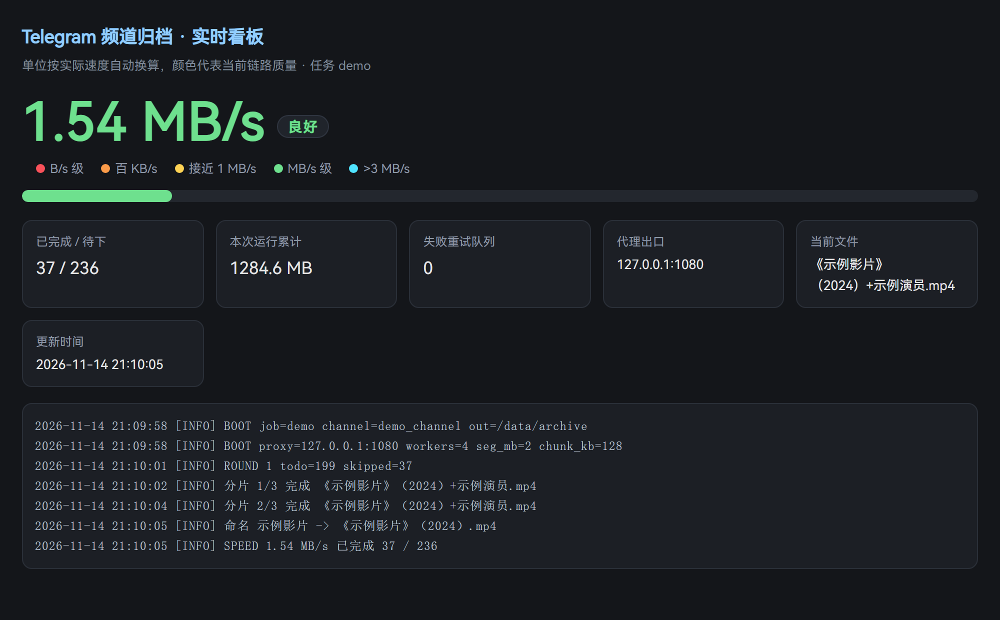
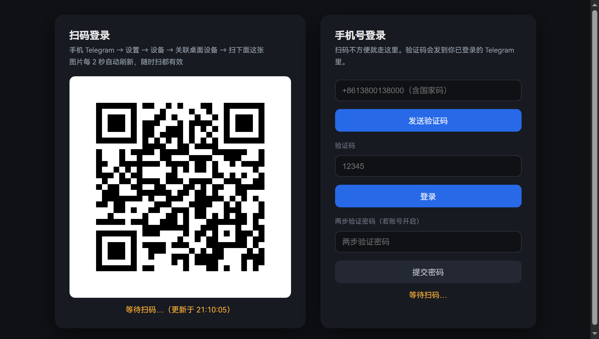

# Telegram 频道批量归档器（tgarchiver）

> 把某个 Telegram 频道里的视频**整批**搬到本地或 NAS：断线自动续传、重名自动加时间戳、实时速度看板。
> 面向需要长期备份自己频道内容、或已获授权归档公开频道的人。

---

## 目录

- [界面预览](#界面预览)
- [1. 这是什么](#1-这是什么)
- [2. 零基础：从没装过 Python 也能跑起来](#2-零基础从没装过-python-也能跑起来)
- [3. 三个真实使用场景](#3-三个真实使用场景)
- [4. 命令逐项说明](#4-命令逐项说明)
- [5. 任务文件字段详解](#5-任务文件job-json字段详解)
- [6. 环境变量与 .env](#6-环境变量与-env)
- [7. 命名规则与重名策略](#7-命名规则与重名策略)
- [8. 实时看板](#8-实时看板)
- [9. 工作原理（技术参考）](#9-工作原理技术参考)
- [10. 排错手册](#10-排错手册)
- [11. FAQ](#11-faq)
- [12. 已知限制与合规说明](#12-已知限制与合规说明)
- [13. 目录结构与自测](#13-目录结构--开发与测试)
- [14. 版本更新简介](#14-版本更新简介)
- [15. 许可](#15-许可与致谢)

---

## 界面预览

> 两张图都是**演示数据**：频道、文件名、代理地址均为占位示例，不含任何真实账号或私人内容。

### 实时速度看板（`monitor.py`）

一眼能读到的四件事：**当前速度**（1.54 MB/s，绿色「良好」）、**进度**（37 / 236）、**现在在下哪个文件**、**最近日志**。速度单位随量级自动切换，颜色跟着速度走——红就是该换线路了。

### 扫码登录页（`qr_server.py` + `login.py`）

左边二维码每 2 秒自动刷新，随时扫都有效；右边是不方便扫码时的手机号 + 验证码 + 两步验证兜底表单。

---

## 1. 这是什么

一句话：**给一个频道链接，它把这个频道里的视频按你的命名规则批量下载到本地，中途断网、换代理、关机重启都不用从头再来。**

| 你是谁 | 它能帮你做什么 |
| --- | --- |
| 频道主 / 运营 | 把自己频道的视频批量备份到 NAS，防止账号异常时内容也一起没了 |
| 研究者 / 档案工作者 | 对公开频道做合规归档，保留原始文件名与消息号对应关系 |
| 普通用户 | 把收藏夹里某个频道的教程视频一次性存下来，慢慢看 |

三个核心能力，其他都是围绕它们：

1. **索引与筛选**：先扫一遍频道，把「哪些是视频、多大、带不带文案」记成 JSON；可以只下带文案的、只下含关键词的、或只下某个体积区间的。
2. **分片级断点续传**：文件切成 2MB 分片，每片单独记录完成状态；代理断了、进程被杀了，重跑同一条命令就从缺的分片继续。
3. **永续重连**：下载器是死循环，连不上就退避重试，不会「失败退出」；你在代理软件里换节点，它自己重连到新出口继续下。

---

## 2. 零基础：从没装过 Python 也能跑起来

### 2.1 准备三样东西

1. **Python 3.9+**（推荐 3.10/3.11）。安装时务必勾选 `Add Python to PATH`。
2. **能连上 Telegram 的网络**。直连不通时，需要本机有一个 SOCKS5 或 HTTP 代理端口（很多代理客户端会给 `127.0.0.1:1080`）。
3. **你自己的 api_id / api_hash**：<https://my.telegram.org> → 手机号登录 → API development tools → 抄下两个值。免费，两分钟。

> 不要用网上流传的公共 api_id：那等于借别人的应用身份登录，被滥用会连累一批人。

### 2.2 装依赖

~~~bat
cd /d G:\Python_Code\telegram-channel-archiver
python -m venv .venv
.venv\Scripts\activate
pip install -r requirements.txt
~~~

国内慢就加镜像 `-i https://pypi.tuna.tsinghua.edu.cn/simple`。
`python-socks` 部分镜像缺失，装不上单独来一次：
`pip install "python-socks[asyncio]" -i https://pypi.org/simple`

### 2.3 填配置

复制 `.env.example` 为 `.env`：

~~~ini
TG_API_ID=1234567
TG_API_HASH=0123456789abcdef0123456789abcdef
TG_PROXY=socks5://127.0.0.1:1080
~~~

- 直连就留空 `TG_PROXY`；代理要密码写 `socks5://用户名:密码@127.0.0.1:1080`；HTTP 代理写 `http://127.0.0.1:8080`。
- `.env` 已被 `.gitignore` 屏蔽，不会进仓库。

### 2.4 第一次登录（扫码，30 秒）

开**两个**命令行窗口，都先激活虚拟环境：

~~~bat
:: 窗口 A
python qr_server.py
:: 窗口 B
python login.py
~~~

浏览器打开 <http://127.0.0.1:47050/>，手机 Telegram → 设置 → 设备 → 关联桌面设备 → 扫码。

- 二维码**每 18 秒自动换一张**，页面每 2 秒重载图片，随时扫都有效，不会「扫的时候正好过期」。
- 扫码不方便就走右侧手机号登录：国家码开头的号码 → 验证码 → 两步验证密码。
- 成功后 `state/tg_session.session` 就是登录态，之后 `index` / `run` 都复用，不用重复登录。

> session 文件等同于账号密码：别外发、别进仓库、别放公共网盘。

### 2.5 索引第一个频道

~~~bat
python tgarchiver.py probe somechannel
python tgarchiver.py new --name demo --channel https://t.me/somechannel --out "D:\Downloads\demo" --selector all
python tgarchiver.py index demo
~~~

`index` 结束会打印：

~~~
21:10:02 INDEX done scanned=3148 titled=1205 selected=1205 28.2GB -> state\demo_index.json
~~~

含义：扫了 3148 条消息，1205 条带文案并命中筛选，合计 28.2GB。

### 2.6 开始下载

~~~bat
python tgarchiver.py run demo
:: 另开一个窗口
python monitor.py
~~~

浏览器打开 <http://127.0.0.1:47060/>：实时速度（自动换算单位并按快慢变色）、已完成/待下、当前文件、失败队列、最近日志。
先小规模试跑加 `--limit 3`。

---

## 3. 三个真实使用场景

### 场景一：只要带文案的视频（最简单）

~~~bat
python tgarchiver.py new --name mychan --channel https://t.me/mychan --out "E:\Archive\mychan" --selector caption --name-mode caption
python tgarchiver.py index mychan
python tgarchiver.py run mychan
~~~

- `--selector caption`：只下「文案里能抽出标题」的视频。
- `--name-mode caption`：文件名 `《标题》（年份）.mp4`。
- 同名同大小已存在 → 跳过，所以同一条命令可以反复跑，不会重复下。

### 场景二：关键词 + 体积区间

~~~bat
python tgarchiver.py new --name lessons --channel https://t.me/somechannel --out "D:\lessons" --selector keyword --keywords 教程,合集 --min-mb 10 --max-mb 500 --name-mode orig
python tgarchiver.py index lessons
python tgarchiver.py run lessons
~~~

- `--selector keyword`：`--keywords` 里任意一个词命中就算。
- `--name-mode orig`：优先用原始文件名，没名字才退回文案标题。

### 场景三：长时间大任务 + 手动换节点

1. 建任务并 `index`；2. `run` 挂着别管；3. 看板变成红色/橙色（速度掉到 KB/s 级）就去代理软件换更快节点；4. 已下载分片不丢，继续从断点补。

> 判断标准只看颜色：红/橙 = 该换，绿/青 = 别动它。

---

## 4. 命令逐项说明

| 命令 | 作用 | 常用参数 |
| --- | --- | --- |
| `probe <频道>` | 只读频道信息，验证登录与网络 | 频道可写 `@name`、`name`、`https://t.me/name` |
| `new` | 新建任务，写 job JSON 到 `state/jobs/` | 见下表 |
| `index <任务>` | 扫频道生成索引（不下载） | — |
| `run <任务>` | 开始/继续下载（死循环，Ctrl+C 停） | `--limit N` 只处理前 N 个 |
| `list` | 列出所有任务与进度 | — |
| `login.py` | 登录（配合 `qr_server.py`） | — |
| `qr_server.py` | 登录页 http 服务 | 端口 `TG_PORT_LOGIN` |
| `monitor.py` | 速度看板 | 端口 `TG_PORT_MONITOR` |

`new` 的参数：

| 参数 | 默认 | 说明 |
| --- | --- | --- |
| `--name` | 必填 | 任务名，也是状态文件前缀 |
| `--channel` | 必填 | 频道标识/链接 |
| `--out` | 必填 | 输出目录，不存在自动建；支持 UNC 如 `\\NAS\share\dir` |
| `--selector` | `caption` | `caption` / `keyword` / `all` |
| `--keywords` | 空 | 逗号分隔，`selector=keyword` 时生效 |
| `--min-mb` / `--max-mb` | `0` | 体积区间，`0` 不限 |
| `--name-mode` | `orig` | `caption` / `orig` / `msgid` |
| `--workers` | `4` | 同一文件的并发分片数 |
| `--ext` | `.mp4` | 落盘扩展名 |
| `--force` | 关 | 同名任务已存在时覆盖 |

---

## 5. 任务文件（job JSON）字段详解

`state/jobs/demo.json` 可以手工改，改完直接 `run`：

~~~json
{
  "name": "demo",
  "channel": "somechannel",
  "out_dir": "D:/Downloads/demo",
  "selector": "caption",
  "keywords": [],
  "min_mb": 0,
  "max_mb": 0,
  "name_mode": "caption",
  "workers": 4,
  "seg_mb": 2,
  "chunk_kb": 128,
  "ext": ".mp4"
}
~~~

| 字段 | 类型 | 含义 | 改了会怎样 |
| --- | --- | --- | --- |
| `name` | str | 任务名 | 决定状态文件前缀；改名前把 `state/` 里对应文件一起改名 |
| `channel` | str | 频道标识 | 换频道要重新 `index` |
| `out_dir` | str | 输出目录 | 换目录等于换一批「已存在」判断，会重下 |
| `selector` | str | 筛选方式 | 改完重新 `index` |
| `keywords` | list | 关键词 | 同上 |
| `min_mb` / `max_mb` | float | 体积过滤 | 同上 |
| `name_mode` | str | 命名方式 | 立即生效；已下文件不会自动改名 |
| `workers` | int | 并发分片数 | 1~4 稳妥；8+ 容易被断流 |
| `seg_mb` | int | 分片大小 | 越小断点越细、请求越多；2 是均衡值 |
| `chunk_kb` | int | 单次请求大小 | 影响测速精度与重试粒度，128 较稳 |
| `ext` | str | 扩展名 | 只影响落盘名，不转码 |

索引 `state/demo_index.json` 每条记录含 `msg_id / size / caption / title / year / name / doc_id / access_hash / file_reference`。
`file_reference` 会过期，索引放几天以上建议重跑 `index`（`run` 内部会重新取最新引用，所以只是索引里的旧值不可用）。

---

## 6. 环境变量与 .env

| 变量 | 必填 | 默认 | 说明 |
| --- | --- | --- | --- |
| `TG_API_ID` | 是 | — | my.telegram.org 的 api_id |
| `TG_API_HASH` | 是 | — | my.telegram.org 的 api_hash |
| `TG_PROXY` | 否 | 空（直连） | `socks5://[user:pass@]host:port` 或 `http://host:port` |
| `TG_STATE_DIR` | 否 | `./state` | 状态目录（session/索引/进度/日志） |
| `TG_PORT_LOGIN` | 否 | `47050` | 登录页端口 |
| `TG_PORT_MONITOR` | 否 | `47060` | 看板端口 |
| `TG_SPEED_FILE` | 否 | `state/speed.json` | 看板读的遥测文件 |
| `TG_LOG_FILE` | 否 | `state/download.log` | 看板显示的日志 |

优先级：系统环境变量 > `.env` > 代码默认值。`config._load_env()` 只在变量**尚未存在**时填值，所以临时覆盖很方便：

~~~bat
set TG_PROXY=socks5://127.0.0.1:7890
python tgarchiver.py run demo
~~~

---

## 7. 命名规则与重名策略

### 7.1 三种命名

| `--name-mode` | 结果示例 | 适用 |
| --- | --- | --- |
| `caption` | `《某部纪录片》（2019）.mp4` | 文案里有《标题》或首行就是标题 |
| `orig` | `原始文件名.mp4`，没有就退回 `caption` | 作者已经规范命名 |
| `msgid` | `somechannel_12345.mp4` | 要与消息号一一对应，做归档索引 |

`caption` 抽取规则（`naming.py`）：

1. 文案里有《书名号》→ 取书名号内文字当标题；
2. 没有书名号 → 取第一行非空文本，去掉表情、标点、空白；
3. 文案里有 `(2019)` 或 `（2019）` → 当年份拼在后面。

### 7.2 重名怎么办

- 同名**同大小**已存在 → 判定已下载，跳过；
- 同名**不同大小** → 扩展名前加时间戳 `《标题》（2019）_20261114_201530.mp4`，同秒再撞加 `_2`；
- 最终名字写进 `state/<job>_progress.json` 的 `#names`，重启后沿用，不会因重跑改名。

### 7.3 非法字符

文件名里的 `< > : " / \ | ? *` 与换行替换成空格，长度截到 150 字符（Windows 单段上限 255 字节，中文名留足余量）。

---

## 8. 实时看板

`python monitor.py` 后打开 <http://127.0.0.1:47060/>。效果见[界面预览](#界面预览)。

- **速度单位自适应**：B/s → KB/s → MB/s → GB/s，按实际量级自动换。
- **分级配色**：`<10KB/s` 红、`<300KB/s` 橙、`<1MB/s` 黄、`<3MB/s` 绿、`≥3MB/s` 青；数字、质量标签、进度条三处同色。
- 卡片：已完成/待下、本次累计 MB、失败队列、代理出口、当前文件、更新时间。
- 底部最近 26 行日志；页面每 2 秒自刷新。

遥测每 5 秒重写，字段：

~~~json
{"ts":"2026-11-14 20:39:07","bps":78643,"mbps":0.075,"session_mb":5.1,
 "files_done":0,"files_total":1,"current":"《标题》.mp4","fail":0,
 "job":"demo","proxy":"socks5://127.0.0.1:1080"}
~~~

> 速度是「块级」的：Telegram 按 `request_size` 整块交付，只有整块收全才计数。块太大（如 512KB）时半途被掐断的流量一个字节都不算，看板会假 0 —— 所以默认 `chunk_kb=128`。

---

## 9. 工作原理（技术参考）

### 9.1 三段式

~~~
login.py ──> state/tg_session.session ──┐
                                        ├──> index ──> state/<job>_index.json
qr_server.py（显示二维码/收表单）        └──> run   ──> 目标目录 + state/<job>_progress.json
                                                       └──> state/<job>_speed.json ──> monitor.py
~~~

- 走 **MTProto**（Telethon），不是网页抓取，所以私有频道、需要登录才能看的内容也能归档 —— 前提是你的账号本来就有权限。
- `index` 只读元数据（`document.size`、`mime_type`、文案），不下内容，三千条消息十几秒扫完。
- `run` 对每个文件：`get_messages(ids=[msg_id])` 取最新 `file_reference` → 按分片 `iter_download(offset, limit, request_size)` → 写 `.part` → 全部完成再 `os.replace` 成正式名。

### 9.2 分片级断点

- 临时文件在**目标目录同卷**的 `__parts/<msg_id>.part`，先 `truncate` 到完整大小，再按 offset 随机写。
  （放别的盘会踩 `OSError: [WinError 17] 系统无法将文件移到不同的磁盘驱动器` —— 跨卷 `os.replace` 必失败。）
- 进度：`{"12345": {"done": [0,1,3], "size": 10485760}}`；`size` 变了说明文件被替换，旧进度自动作废。
- 单分片重试 5 次（1s/3s/5s…）；单文件连续 3 片失败 → 记入 deferred，本轮跳过，整轮后再补。

### 9.3 换代理为什么不断

`get_client()` 是无限重试循环：失败就 `sleep(min(20, 2+attempt*2))` 再连。代理软件换节点（本地端口不变）→ 旧连接断、`fetch_seg` 捕获异常重试 → 新连接走新节点。改 `.env` 里的端口则需重启 `run`。

### 9.4 性能与瓶颈

- 单连接吞吐主要受**代理出口**与 Telegram 单连接限速约束，本机带宽通常不是瓶颈。
- 同一文件加并发收益递减：1→4 有小幅提升，8+ 容易 `AuthBytesInvalidError`（同 auth key 连接被服务端注销）。
- 多文件各开连接也不简单相加，总量仍受出口约束 —— **换更快节点永远比调参有效**。

---

## 10. 排错手册

| 现象 | 原因 | 解决 |
| --- | --- | --- |
| `缺少 TG_API_ID / TG_API_HASH` | 没建 `.env` 或没读到 | 复制 `.env.example` 填值，或 `set TG_API_ID=...` |
| `ModuleNotFoundError: telethon` | 依赖没装 / 用错解释器 | 激活 venv 后 `pip install -r requirements.txt` |
| `ModuleNotFoundError: python_socks` | 走代理必需 | `pip install "python-socks[asyncio]" -i https://pypi.org/simple` |
| 一直 `TimeoutError` / 重连 | 网络不通、代理没开 | 先 `probe`；检查 `TG_PROXY` 端口 |
| `Server closed the connection: 0 bytes read on a total of 8 expected bytes` | 代理在高流量下掐连接（常见） | 不是代码 bug；`workers` 降到 2~4 或换节点 |
| `[WinError 64] 指定的网络名不再可用` | 本地代理入口抖动 | 同上 |
| `AuthBytesInvalidError` | 同 auth key 并发连接太多被注销 | 降 `workers`；确认没有第二个 `run` 抢同一 session |
| `sqlite3.OperationalError: database is locked` | 两个进程同时用同一 session | 只留一个 `run`；诊断脚本要复制 session |
| `Could not find the input entity for PeerUser` | 用数字 id 解析公开频道失败 | 本版按 username 解析；旧索引重跑 `index` |
| `[WinError 17] 系统无法将文件移到不同的磁盘驱动器` | `.part` 与目标不同卷 | 保持 `parts_dir_name` 在 `out_dir` 之下 |
| 看板 0 B/s 但文件在涨 | 旧版 `chunk_kb` 太大，块未收全不计量 | 用默认 `chunk_kb=128` |
| 看板打不开 | `monitor.py` 没起 / 端口被占 | `set TG_PORT_MONITOR=47061` |
| 二维码不刷新 | `login.py` 没在跑 | 两个窗口都要开；看有没有 `QR new` |
| 扫码后一直 `NEED_2FA` | 账号开了两步验证 | 登录页右侧填两步验证密码 |
| 要复制 session 到别处 | 直接拷会得到损坏的 sqlite | 用 `sqlite3` 的 backup：`a=sqlite3.connect(src); a.backup(sqlite3.connect(dst))` |

日志位置：`state/<job>.log`（下载器）、`state/login_status.json`（登录状态机）、`state/<job>_speed.json`（遥测）。

---

## 11. FAQ

**Q1：能不能只下最近的 N 条？** 先 `index`，再 `run --limit N`（按体积从小到大取 N 个）。

**Q2：能不能多开进程并行？** 不建议。同一 session 会被两个进程锁住（`database is locked`）；要并行请用 sqlite backup 复制 session，并把任务分到不同 `out_dir`。

**Q3：删了某个文件重跑会重下吗？** 会。判定依据是「目录里有没有同名同大小文件」。

**Q4：两台机器用同一账号会冲突吗？** 不会互踢，但会互相挤占，且容易触发风控。建议一台一个任务。

**Q5：私有频道能用吗？** 能，只要你的账号已加入该频道。`probe` 能打印标题就说明能看到。

**Q6：能下图片/文档/音频吗？** 当前只处理 `mime_type` 以 `video` 开头的消息；扩展改 `cmd_index` 里的过滤条件即可。

**Q7：`file_reference` 过期怎么办？** 重跑 `index`。`run` 内部会重新取引用，不影响正确性。

**Q8：中文/特殊字符会出问题吗？** 会做非法字符替换与长度截断（150 字符）；极长标题可能丢尾部信息。

**Q9：为什么速度颜色一直红？** 代理出口慢或被限速。换节点，别调 `workers`。

**Q10：下载完会自动退出吗？** 不会。`ALL DONE` 后每 120 秒轮询新消息；要停就 Ctrl+C。

**Q11：能只下某个时间段吗？** 当前没有时间参数。`index` 后手工筛 `state/<job>_index.json` 的 `date` 字段再 `run`。

**Q12：日志会无限增长吗？** 会。定期清理 `state/*.log`，不影响断点（断点在 `_progress.json`）。

---

## 12. 已知限制与合规说明

- **只下载你本来就能看到的内容**。工具不做越权、破解、绕过付费墙的事，只是把你账号有权限的东西搬到自己的硬盘。
- 请遵守 Telegram 服务条款与当地法律；归档他人作品前确认你有相应权利或授权。
- 不转码、不合并、不去水印，落盘就是原始字节。
- 速度上限由代理出口决定，文中所有数字都是实测参考，不是承诺。
- session 文件是账号凭据：不要提交、不要外发、不要放公共网盘。
- Windows 上的路径长度、UNC、跨卷移动都有坑，已在上文标注；Linux/macOS 未做完整验证。

---

## 13. 目录结构 / 开发与测试

~~~
telegram-channel-archiver/
├─ tgarchiver.py      # 主程序：new / index / run / list / probe
├─ login.py           # 登录（QR + 手机号 + 两步验证）
├─ qr_server.py       # 登录页：显示二维码、收表单
├─ monitor.py         # 速度看板（自适应单位 + 分级配色）
├─ naming.py          # 标题/年份抽取、文件名安全化
├─ config.py          # 环境变量/.env 解析、代理参数解析
├─ requirements.txt
├─ .env.example       # 复制成 .env 后填写
├─ INSTALL.txt        # 三步安装
├─ 软件升级迭代记录.md
└─ state/             # 运行时生成（session/索引/进度/日志/遥测），已被 .gitignore
~~~

自测清单（改完代码至少跑一遍）：

~~~bat
python tgarchiver.py list
python tgarchiver.py probe <任意能访问的公开频道>
python tgarchiver.py new --name t --channel <同上> --out "%TEMP%\t" --selector all --max-mb 20 --name-mode caption --force
python tgarchiver.py index t
python tgarchiver.py run t --limit 1   :: 看到 part 增长、看板有速度即可 Ctrl+C
~~~

---

## 14. 版本更新简介

| 版本 | 日期 | 一句话变更 |
| --- | --- | --- |
| v1.0.0 | 2026-11-14 | 首个公开版：索引/筛选/分片续传/永续重连/自适应单位看板/扫码登录 |

> 2026-11-14 文档补充：新增「界面预览」两张截图（演示数据），代码零改动，版本号不升。

---

## 15. 许可与致谢

- 许可：MIT（见 [LICENSE](LICENSE)）。
- 依赖：[Telethon](https://github.com/LonamiWebs/Telethon)、[python-socks](https://github.com/romis2012/python-socks)、[qrcode](https://github.com/lincolnloop/python-qrcode)。
- 字体：界面优先 HarmonyOS Sans / 思源黑体 / 阿里巴巴普惠体 等免费可商用字体。
